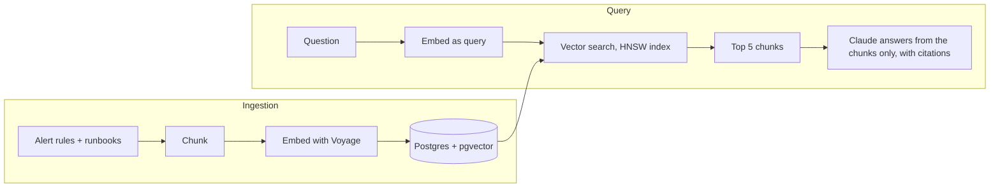

# Alert Runbook RAG

Give it an infrastructure alert or a symptom ("HostOutOfMemory", "my helm release is stuck"), and it returns the relevant runbook steps with citations to the source document. It says so when the runbooks do not cover the question.

I built this from scratch (TypeScript, Postgres + pgvector, no LangChain or LlamaIndex) to understand how retrieval-augmented generation works end to end, and to measure each change rather than guess. It is a work in progress; the status section says exactly what is done.

## Example

```text
$ npm run ask -- "helm upgrade is hanging and the release never finishes"

1. Confirm the symptom: auto-deploys fail with `Error: UPGRADE FAILED: another operation
   (install/upgrade/rollback) is in progress`. Deploys longer than 90 minutes time out, and
   Helm's own rollback can also time out, leaving the release `failed`, `pending-rollback`, or both [1].
...
5. **Do not use `helm rollback`.** It rolls the running code back to a previous version, which
   may not be safe because post-deployment migrations may already have run. Always roll
   forward when Helm is stuck [4].
6. Delete the Helm release secret for each stuck revision ... [3]

Sources:
  [1] kube/helm-upgrade-stuck.md > Helm Upgrade is Stuck > Evidence   (MIT)
  [3] kube/helm-upgrade-stuck.md > Helm Upgrade is Stuck > Remediation   (MIT)
  [4] kube/helm-upgrade-stuck.md > Helm Upgrade is Stuck > Remediation   (MIT)
```

Step 5 is why grounding matters: the runbook warns against the command that general advice would recommend. A question the corpus cannot answer ("GitHub Actions runners are all offline") gets `Not found in the runbooks.` instead of an invented answer.

## How it works



| Stage      | What I did                                                                                                                          | Why (details in [`docs/DECISIONS.md`](docs/DECISIONS.md))                                     |
| ---------- | ----------------------------------------------------------------------------------------------------------------------------------- | --------------------------------------------------------------------------------------------- |
| Data       | Prometheus alert rules (CC BY 4.0) and a slice of GitLab's public runbooks (MIT), both pinned to a commit                           | Public, licensed, and complementary: alerts say what is wrong, runbooks say what to do        |
| Chunking   | One chunk per alert rule; runbooks split by heading, 1,500-character cap, 150-character overlap, heading path written into the text | Only a chunk's text is embedded, so context that should affect matching has to be in the text |
| Embeddings | Voyage `voyage-4-lite`, 1,024 dimensions, `document` vs `query` input types                                                         | Cheap, and the input types help short questions land near long passages                       |
| Storage    | Postgres + pgvector, HNSW index (cosine), one transaction per document                                                              | One database; the transaction stops a half-written file from being skipped forever            |
| Re-runs    | A hash of the file content plus chunking/embedding settings decides what to re-embed                                                | A second ingest costs nothing: 129 documents, 0 tokens                                        |
| Generation | Claude Sonnet 5.5, answers only from numbered sources, `[n]` citations checked in code                                              | Prevents unsafe general advice; makes every step traceable                                    |

## Results

Retrieval is measured on 44 hand-checked questions (40 with an answer in the corpus, 4 without): exact alert names, plain-language symptoms, vague descriptions, and pasted alert text. A question counts as a hit when an expected runbook file or alert appears in the top 5. Full details and a log of every run are in [`docs/EVAL_RESULTS.md`](docs/EVAL_RESULTS.md).

Baseline (vector search only):

|                             | hit@1 | hit@5 | MRR   |
| --------------------------- | ----- | ----- | ----- |
| All 40 answerable questions | 80.0% | 97.5% | 0.865 |
| Exact alert name (10)       | 100%  | 100%  | 1.000 |
| Pasted alert text (5)       | 100%  | 100%  | 1.000 |
| Plain-language symptom (21) | 76.2% | 100%  | 0.859 |
| Vague (4)                   | 25.0% | 75.0% | 0.396 |

What the baseline shows:

- The right source is usually found, but often not first. For symptom questions an alert description frequently ranks above the runbook that has the fix steps.
- Vague questions are the weak spot ("database is slow right now" missed; three of its five results were the same section).
- Near-duplicate chunks can waste slots in the top 5.

Caveats: 40 questions is small (one question moves the score 2.5 points), marking is by file so finding the wrong section of the right file still counts, and I drafted the question set with Claude from the source files (without running searches) and then reviewed it. See decisions D11 and D12.

Generation is **not** evaluated yet. I have spot-checked a handful of answers by hand. The code verifies that every citation points to a real source, but not that the source supports the claim. One known behaviour: for "my helm release is stuck in pending-upgrade" the right runbook was retrieved, but the model answered "Not found" because the runbook describes `failed` and `pending-rollback`, not `pending-upgrade`. Whether that is too strict is something I intend to measure.

## Status

- [x] Ingestion: chunking, embeddings, idempotent loading
- [x] Vector search with an HNSW index
- [x] Retrieval eval set and baseline
- [x] Generation: grounded answers with citations (first version, not yet evaluated)
- [ ] Generation eval (faithfulness, "not found" behaviour)
- [ ] Hybrid search: Postgres full-text + vector, fused with Reciprocal Rank Fusion
- [ ] Re-ranking

## Run it

You need Node.js 20+, Docker, a [Voyage AI](https://www.voyageai.com/) API key, and (for `ask`) an [Anthropic](https://console.anthropic.com/) API key. Voyage's free tier without a payment method is rate-limited to a few requests per minute, which makes ingestion slow. Ingesting the whole corpus used about 442K embedding tokens. An `ask` call costs roughly a cent.

```bash
npm install
cp .env.example .env        # then add your two API keys
npm run db:up               # Postgres + pgvector in Docker
npm run db:migrate
npm run data:fetch          # downloads the two pinned data sources into data/
npm run ingest              # chunk, embed, store (run it again: it skips everything)

npm run search -- "redis memory is almost full"
npm run ask -- "helm upgrade is hanging and the release never finishes"
npm run eval                # retrieval eval over eval/queries.yaml
npm test                    # unit tests; integration tests skip themselves if the database is down
```

## Project layout

```text
src/ingestion/   chunkers, Voyage client, document loader, idempotent store
src/query/       vector search, prompt assembly, answer generation
src/eval/        eval set loader, matching, scoring
src/cli/         the npm run entry points
migrations/      SQL schema and HNSW index
eval/            the question set and expected answers
docs/            design decisions, eval results, data sources
```

## Data and credits

The data is not stored in this repository; `npm run data:fetch` downloads it from the original projects.

- **[awesome-prometheus-alerts](https://github.com/samber/awesome-prometheus-alerts)** by samber and contributors, licensed [CC BY 4.0](https://creativecommons.org/licenses/by/4.0/). Changes: split into one chunk per rule, query expressions left out of the embedded text.
- **[GitLab runbooks](https://gitlab.com/gitlab-com/runbooks)**, Copyright (c) GitLab, Inc., MIT license. Five folders of markdown files, split by heading.

## License

Code: [MIT](LICENSE). Data sources keep their own licenses, as above.
